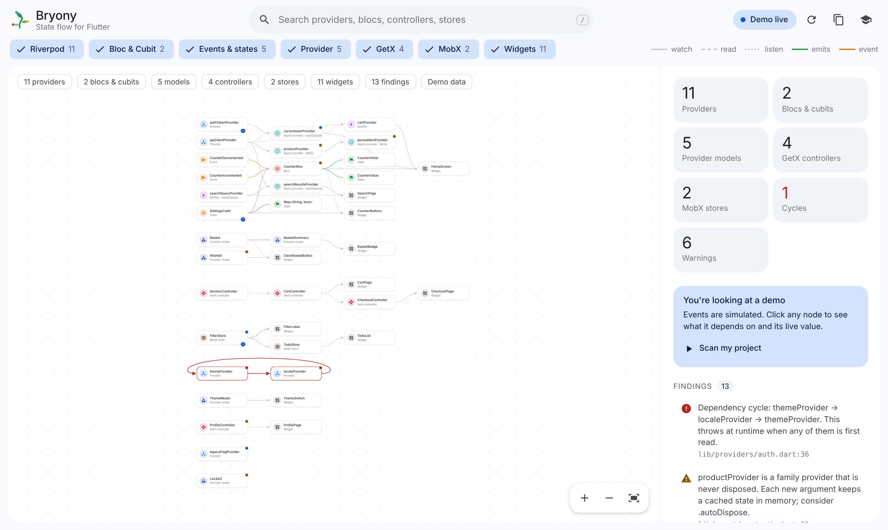
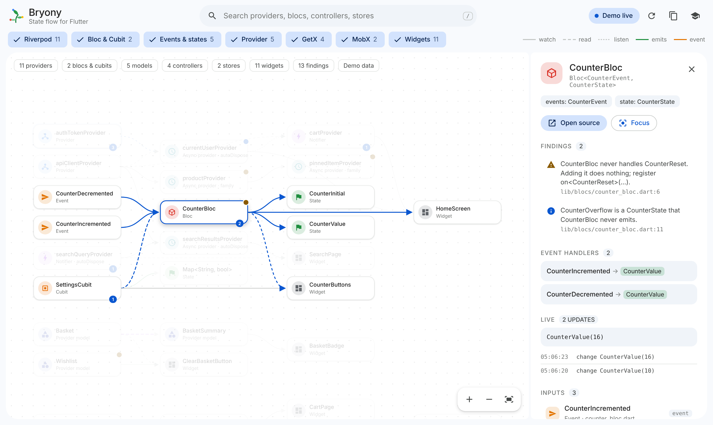
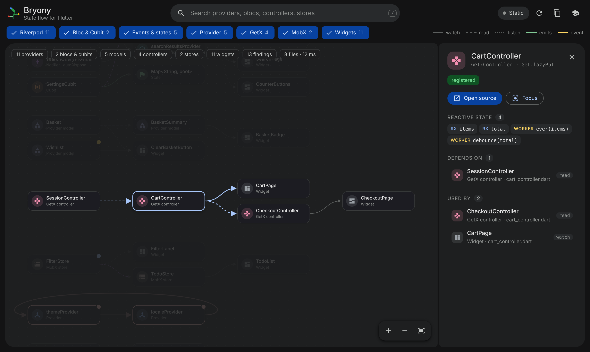
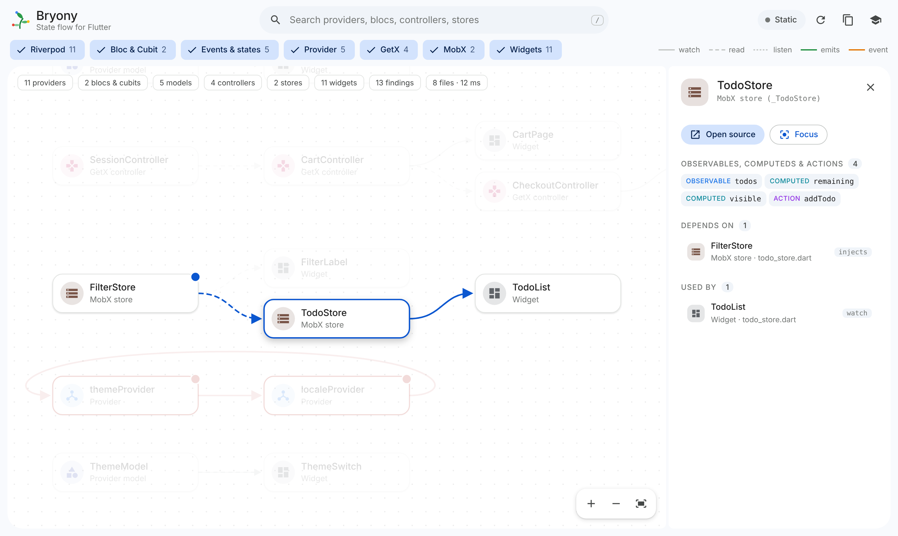
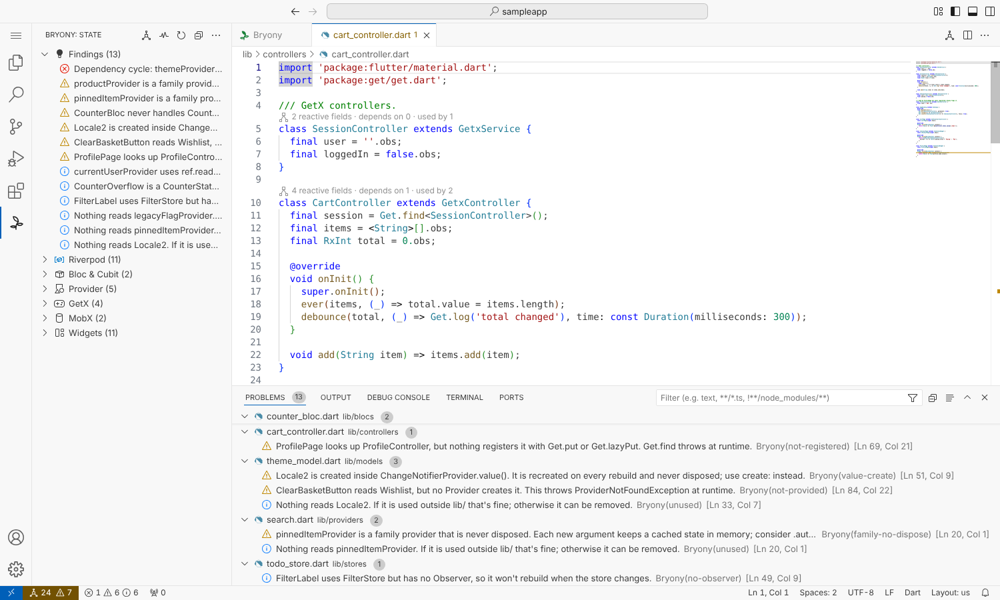

<h1 align="center">Bryony: State Flow for Flutter</h1>

  See how state flows through your Flutter app, right inside VS Code. 
  Riverpod · Bloc &amp; Cubit · Provider · GetX · MobX

  <a href="https://marketplace.visualstudio.com/items?itemName=sanket-manohar.bryony"><b>Install from the Visual Studio Marketplace</b></a>
  ·
  <a href="https://sanket-manohar.github.io/bryony/">Website</a>
  ·
  <a href="https://github.com/sanket-manohar/bryony/issues">Report an issue</a>

## Why Bryony

In a growing Flutter app it gets hard to answer simple questions. What does this provider depend on? Which widgets rebuild when it changes? Which events produce which states? Why does `Get.find` throw here? Bryony answers them in the editor, with no code changes and no separate DevTools window.

## Features

- **One graph for five state libraries.** Riverpod (manual providers and `@riverpod`), Bloc and Cubit with their events and states, Provider models, GetX controllers and MobX stores, plus the widgets that use them.
- **Trace anything.** Click a node to light up everything upstream and downstream. Double-click to jump to the code.
- **Findings that matter**, on the graph and in the Problems panel:
  - dependency cycles,
  - Bloc events that are never handled and states never emitted,
  - `.family` providers that are never disposed,
  - `ref.read` while building,
  - Provider models that nobody provides, or that are created inside `.value(...)`,
  - GetX controllers that are looked up but never registered,
  - widgets that use a MobX store without an `Observer`,
  - state that nothing reads.
- **Live mode.** One command adds a small debug-only observer. While you debug, nodes pulse and show their latest value and a timeline. Works with Riverpod 2 and 3, Bloc, GetX and MobX.
- **Editor integration.** CodeLens counts above each provider, Bloc, model, controller and store; a sidebar; a status bar summary; and "Show in graph" from the cursor.
- **Copy as Mermaid** to paste the graph into docs and pull requests.
- **Material design** that follows your light, dark or high-contrast theme, with a demo graph and a short tour.

| Live mode | GetX controller details |
|---|---|
|  |  |
| **MobX store details** | **Findings in VS Code** |
|  |  |

## Getting started

1. Install **Bryony** from the [Visual Studio Marketplace](https://marketplace.visualstudio.com/items?itemName=sanket-manohar.bryony), or search for "Bryony" in the Extensions view.
2. Open a Flutter project.
3. Press `Ctrl+Alt+G` (`Cmd+Alt+G` on macOS), or click the leaf icon in the Activity Bar.
4. For live mode, run **Bryony: Set Up Live Mode** from the Command Palette, then start debugging.

No project handy? Run **Bryony: Open Demo Graph**.

Works on Windows, macOS and Linux with VS Code 1.85 or later. Bryony analyzes your code on your own machine and sends nothing anywhere.

## Feedback

Found a bug or have an idea? [Open an issue](https://github.com/sanket-manohar/bryony/issues). This repository holds documentation and releases; the extension's source code is not public.

## License

Copyright (c) 2026 Sanket Santosh Vidya Manohar. All rights reserved.

Bryony is free to install and use. Copying, modifying, redistributing or repackaging it is not allowed. See [LICENSE](LICENSE) for the full terms.

Flutter, Dart, Riverpod, Bloc, Provider, GetX and MobX are trademarks of their respective owners. Bryony is an independent tool and is not affiliated with or endorsed by them.
